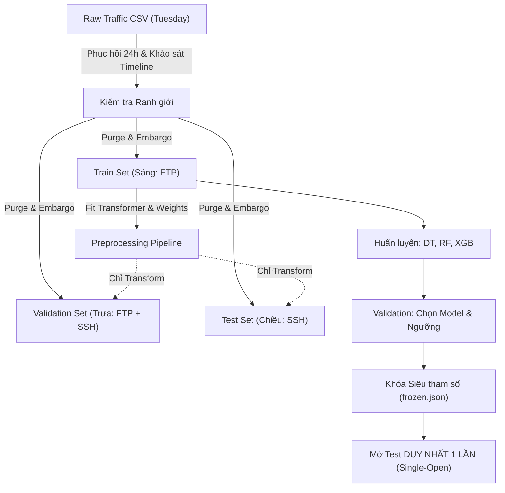

<div align="center">

# 🛡️ CICIDS2017 Brute Force Detection: Temporal Generalization & Data Leakage Benchmark

**Đánh giá thực nghiệm khả năng tổng quát hóa theo thời gian và vạch trần độ lệch lạc quan (Data Leakage) của mô hình học máy trong phát hiện tấn công mạng.**

[](LICENSE)
[](https://www.python.org/)
[](https://scikit-learn.org/)
[](https://xgboost.readthedocs.io/)
[](https://shap.readthedocs.io/)
[](.github/workflows/ci.yml)

**[🚀 Quick Start](#-quick-start) • [📊 Kết quả Thực nghiệm](#-tóm-tắt-kết-quả-thực-nghiệm-benchmark) • [🛡️ Quy chuẩn Chống Leakage](#-quy-chuẩn-khoa-học--chống-data-leakage) • [❓ FAQ](#-faq) • [📖 Báo cáo Đồ án](docs/BAO_CAO_THUC_NGHIEM_W3_W4.md)**

**Tiếng Việt** | [English](README.en.md)

<br/>


</div>

---

## 📌 Giới thiệu & Tác dụng của Repository

Trong nghiên cứu áp dụng Trí tuệ nhân tạo (AI/ML) vào Hệ thống Phát hiện Xâm nhập Mạng (NIDS), phần lớn các nghiên cứu học thuật đạt **F1-Score xấp xỉ 99.9%** trên tập dữ liệu chuẩn như **CICIDS2017**. Tuy nhiên, khi đưa vào môi trường mạng thực tế, các hệ thống này thường **thất bại hoàn toàn** trước các đợt tấn công mới.

**Repository này chứng minh và định lượng nguyên nhân cốt lõi:**
1. **Ảo tưởng đánh giá ngẫu nhiên (Optimistic Bias of Random Split)**: Việc xáo trộn ngẫu nhiên dữ liệu (`train_test_split`) xé nhỏ các flow trong cùng một chiến dịch tấn công sang cả hai tập Train và Test, dẫn đến rò rỉ dữ liệu (Data Leakage). Mô hình chỉ "ghi nhớ lại" mẫu thay vì học quy luật.
2. **Lối tắt cổng dịch vụ (Destination Port Shortcut)**: Mô hình học vẹt rằng `Port 21 = FTP Attack`, `Port 22 = SSH Attack`. Khi tấn công dịch chuyển sang cổng khác hoặc biến thể mới, mô hình sụp đổ (F1 rơi từ 99.9% về 0.0%).
3. **Quy chuẩn thực nghiệm kiểm toán được (Auditable Protocol)**: Cung cấp framework chuẩn mực với cơ chế **Purge & Embargo window**, cô lập tiền xử lý (chỉ `fit` trên Train), và **Single-open Test Rule** (khóa Test, chỉ chấm điểm đúng một lần).

> [!NOTE]
> Repository cung cấp trọn vẹn pipeline mã nguồn kiểm toán được, bộ sinh dữ liệu giả lập tự kiểm thử trong 30 giây, 6 biểu đồ khoa học chuẩn công bố (300 DPI), và báo cáo thực nghiệm chuyên sâu.

---

## ✨ Điểm nổi bật & So sánh Phương pháp

| Tiêu chí | Tiếp cận Ngây thơ (Phổ biến) | Tiếp cận Chuẩn mực (Repo này) |
|---|---|---|
| **Chiến lược chia dữ liệu** | Random Split (`train_test_split`) xáo trộn | **Time-based Split** (Train trước, Validation giữa, Test sau) |
| **Kiểm soát ranh giới** | Bỏ qua, để flow kéo dài tràn qua các tập | **Purge & Embargo**: Loại bỏ hoàn toàn flow vắt qua ranh giới |
| **Tiền xử lý & Imputation** | Fit scaler/imputer trên toàn bộ dataset | **Strict Train-only fit**: Chỉ học tham số trên tập Train |
| **Không gian đặc trưng** | Giữ IP, Timestamp, Port gây shortcut | **Port Ablation**: Thử nghiệm đối chiếu cả `with_port` và `without_port` |
| **Đánh giá tập Test** | Chạy nhiều lần, tinh chỉnh tham số theo Test | **Single-open Test Rule**: Khóa mô hình trên Val, mở Test duy nhất 1 lần |
| **Giải thích mô hình** | Hộp đen (Black-box), chỉ nhìn Accuracy | **Explainable AI (XAI)**: Phân tích SHAP TreeExplainer & cấu trúc cây |

---

## 📊 Tóm tắt Kết quả Thực nghiệm (Benchmark)

Thực nghiệm đối chuẩn 3 họ mô hình cây: **Decision Tree (Baseline)**, **Random Forest (Bagging)**, và **XGBoost (Boosting)** trên tập dữ liệu **CICIDS2017 Tuesday** (FTP-Patator & SSH-Patator).

### 1. Kịch bản Thực tế theo Thời gian (Time-based Split) — Thách thức Zero-Shot
> **Điều kiện**: Huấn luyện **duy nhất trên tập Train** (buổi sáng, 100% `FTP-Patator`). Đánh giá trên tập **Test** (buổi chiều, 100% `SSH-Patator`).

| Mô hình | Không gian đặc trưng | Test Accuracy | Precision | Recall | F1-Score | SSH Recall | FTP Recall | Đánh giá hiện tượng |
|---|---|:---:|:---:|:---:|:---:|:---:|:---:|---|
| **Decision Tree** | With Port (67 feats) | 0.9740 | 0.0000 | 0.0000 | **0.0000** | 0.00% | N/A | Cây rẽ nhánh `Port <= 21.5`, bỏ sót toàn bộ 3,732 flow SSH |
| **Random Forest** | With Port (67 feats) | **0.9742** | **1.0000** | **0.0019** | **0.0037** | **0.19%** | N/A | Bắt được 7 flow SSH nhờ ngẫu nhiên chọn tập con feature |
| **XGBoost** | With Port (67 feats) | 0.9741 | 0.0000 | 0.0000 | **0.0000** | 0.00% | N/A | Bất lực trước port mới, gán nhãn toàn bộ SSH là BENIGN |
| **Decision Tree** | Without Port (66 feats)| 0.9741 | 0.4375 | 0.0019 | **0.0037** | 0.19% | N/A | Bỏ port không giải quyết được zero-shot do hành vi packet khác biệt |
| **Random Forest** | Without Port (66 feats)| 0.9739 | 0.2414 | 0.0038 | **0.0074** | 0.38% | N/A | Tăng nhẹ recall nhưng kéo theo 44 ca báo động giả (FP) |
| **XGBoost** | Without Port (66 feats)| 0.9740 | 0.2653 | 0.0035 | **0.0069** | 0.35% | N/A | Tương tự RF, tỷ lệ nhận diện biến thể mới thực tế dưới 1% |

### 2. Kịch bản Đối chứng Ngẫu nhiên (Random Split) — Độ lệch Lạc quan Giả tạo
> **Điều kiện**: Xáo trộn ngẫu nhiên toàn bộ flow trong ngày Tuesday giữa Train, Validation và Test.

| Mô hình | Không gian đặc trưng | Test Accuracy | Precision | Recall | F1-Score | SSH Recall | FTP Recall |
|---|---|:---:|:---:|:---:|:---:|:---:|:---:|
| **Decision Tree** | With Port (67 feats) | 0.9996 | 0.9904 | 0.9980 | **0.9942** | 99.54% | 100.0% |
| **Random Forest** | With Port (67 feats) | **0.9999** | **1.0000** | **0.9993** | **0.9997** | 99.85% | 100.0% |
| **XGBoost** | With Port (67 feats) | **0.9999** | 0.9993 | **1.0000** | **0.9997** | 100.0% | 100.0% |
| **Decision Tree** | Without Port (66 feats)| 0.9989 | 0.9700 | 0.9949 | **0.9823** | 99.23% | 99.69% |
| **Random Forest** | Without Port (66 feats)| 0.9997 | 0.9934 | 0.9954 | **0.9944** | 99.28% | 99.73% |
| **XGBoost** | Without Port (66 feats)| 0.9999 | 0.9980 | 0.9987 | **0.9984** | 99.79% | 99.92% |

> [!WARNING]
> **Kết luận cốt lõi:** Điểm F1 xấp xỉ 99.9% ở Random Split không phản ánh khả năng thông minh của mô hình mà là bằng chứng của **Data Leakage**. Khi triển khai theo thời gian thực đối mặt với biến thể tấn công mới (SSH), mô hình sụp đổ hoàn toàn.

---

## 🚀 Quick Start

Repo đi kèm bộ sinh dữ liệu giả lập (Synthetic Data Generator) giúp người dùng **clone về và chạy kiểm thử toàn bộ pipeline trong 30 giây** mà không cần tải bộ dữ liệu raw 10 GB.

### 1. Cài đặt Môi trường

```bash
# Clone repository
git clone https://github.com/Tuannll/cicids-bruteforce-ids.git
cd cicids-bruteforce-ids

# Khởi tạo môi trường ảo Python 3.11 hoặc 3.12
python -m venv .venv

# Kích hoạt môi trường (Windows PowerShell)
.\.venv\Scripts\Activate.ps1
# Hoặc trên Linux/macOS:
# source .venv/bin/activate

# Cài đặt package ở chế độ editable cùng tiện ích XAI
pip install -e ".[xai]"
```

### 2. Chạy Demo Nhanh (3 Giây)

Chạy ngay mô hình đã huấn luyện trên 2 flow mẫu (FTP Port 21 vs SSH Port 22) để quan sát trực tiếp hiện tượng Port Shortcut & Zero-Shot:

```bash
python demo.py
```

### 3. Chạy Kiểm thử Toàn diện (Smoke Test)

Tái lập toàn bộ pipeline đầu-cuối từ sinh dữ liệu giả lập, tiền xử lý, huấn luyện 3 mô hình, đánh giá Test đến phân tích SHAP:

```bash
python scripts/smoke_test.py --output demo_run --explain
```

### 4. Thử nghiệm Dự đoán Flow Tùy biến (CLI Inference)

```bash
ids predict --config demo_run/configs/demo.yaml --input demo_run/example_flow.json
```

### 5. Sinh Bộ 6 Biểu đồ Khoa học (300 DPI)

```bash
python scripts/generate_detailed_visualizations.py
```
*Toàn bộ biểu đồ phân tích cấu trúc cây, đường cong PR/ROC, ma trận nhầm lẫn và SHAP sẽ được lưu tại `experiments/figures/`.*

---

## 🛡️ Quy chuẩn Khoa học & Chống Data Leakage



1. **Hợp đồng Ranh giới (Data Boundary Contract)**:
   - Các biến đổi dữ liệu (loại cột hằng số, tính toán median để điền khuyết thiếu, tính toán `class_weight` / `scale_pos_weight`) **chỉ được `fit` trên tập Train**.
   - Tuyệt đối không dùng dữ liệu Validation hay Test để chọn đặc trưng hoặc chuẩn hóa.
2. **Quy tắc Single-open Test**:
   - Sau khi các siêu tham số và mô hình chiến thắng được chốt trên tập Validation, tập Test chỉ được mở đúng một lần để ghi nhận kết quả.
   - Tuyệt đối không quay lại tinh chỉnh tham số sau khi đã nhìn thấy điểm Test.

---

## ❓ FAQ

<details>
<summary><b>1. Tại sao điểm F1 trên tập Test theo thời gian lại bằng 0%, có phải mô hình bị lỗi?</b></summary>
<br/>
Không. Đây chính là phát hiện khoa học quan trọng nhất của đồ án. Tập Train diễn ra vào buổi sáng và chỉ có tấn công <code>FTP-Patator</code>, trong khi tập Test diễn ra vào buổi chiều và chỉ có <code>SSH-Patator</code>. Các mô hình cây khi thấy cổng dịch vụ đã phân nhánh dựa trên cổng (ví dụ: <code>Destination Port &lt;= 21.5</code>). Khi gặp tấn công SSH trên cổng 22, mô hình coi đây là lưu lượng bình thường (BENIGN). Ngay cả khi bỏ cổng (Port Ablation), hành vi thống kê gói tin của SSH khác biệt với FTP khiến việc phát hiện zero-shot bằng Supervised ML cổ điển thất bại.
</details>

<details>
<summary><b>2. Tại sao Random Split lại đạt F1 lên tới 99.9%?</b></summary>
<br/>
Phép chia ngẫu nhiên vi phạm giả định độc lập thời gian (I.I.D) của dữ liệu chuỗi. Một đợt tấn công Brute Force gồm hàng chục nghìn flow liên tiếp có cùng địa chỉ IP, cổng và đặc tính gói tin tương đồng. Khi chia ngẫu nhiên, các flow của cùng một đợt tấn công bị xé lẻ vào cả Train và Test. Mô hình chỉ cần "nhớ lại" mẫu đã gặp là đạt điểm tuyệt đối.
</details>

<details>
<summary><b>3. Bỏ Destination Port có giúp mô hình nhận diện được tấn công mới không?</b></summary>
<br/>
Không đáng kể. Kết quả thực nghiệm cho thấy khi bỏ cổng mạng, F1-Score chỉ tăng từ 0.0000 lên 0.0074 (Random Forest bắt được 14/3,732 flow SSH), nhưng đổi lại tạo ra 44 ca báo động giả (False Positive). Điều này chứng minh các đặc trưng thống kê luồng (flow duration, inter-arrival time) giữa FTP và SSH có sự khác biệt lớn, không thể tự động tổng quát hóa nếu không có kỹ thuật học chuyển giao (Transfer Learning) hoặc phát hiện dị biệt (Anomaly Detection).
</details>

<details>
<summary><b>4. Tôi không có file CSV CICIDS2017 gốc (10GB) thì có chạy được repo không?</b></summary>
<br/>
Hoàn toàn được! Repo cung cấp script <code>scripts/smoke_test.py</code> và <code>scripts/make_demo_data.py</code> sinh dữ liệu giả lập có đầy đủ đặc trưng, nhãn thời gian và cấu trúc như dữ liệu thật. Bạn có thể kiểm chứng toàn bộ luồng huấn luyện, xuất artifact và vẽ biểu đồ chỉ trong vài giây.
</details>

<details>
<summary><b>5. Hệ thống này có thể triển khai thành IDS thời gian thực (như Snort/Suricata) không?</b></summary>
<br/>
Mô hình hoạt động trên dữ liệu thống kê flow hoàn tất (completed network flows) được trích xuất từ công cụ như CICFlowMeter. Để đưa vào thực tế, cần kết hợp kiến trúc lai (Hybrid IDS): dùng Snort/Suricata bắt luật và rate-limiting nhanh ở tầng gói tin, kết hợp mô hình ML ở tầng sau để phân tích hành vi phiên và giảm cảnh báo giả.
</details>

---

## 🛠️ Công nghệ Sử dụng

- **Ngôn ngữ**: Python 3.11 / 3.12
- **Thư viện Học máy**: `scikit-learn` (Decision Tree, Random Forest), `xgboost` (Extreme Gradient Boosting)
- **Giải thích Mô hình (XAI)**: `shap` (TreeExplainer)
- **Xử lý Dữ liệu**: `pandas`, `numpy`, `PyYAML`, `joblib`
- **Trực quan hóa**: `matplotlib` (xuất đồ họa 300 DPI)
- **Tài liệu & Báo cáo**: LaTeX (chuẩn quy cách HUCE), Mermaid.js

---

## 📂 Cấu trúc Thư mục

```text
cicids-bruteforce-ids/
├── .github/workflows/       # Tự động hóa CI chạy kiểm thử trên GitHub Actions
├── configs/                 # File cấu hình tham số thực nghiệm (experiment.yaml)
├── data/                    # Thư mục dữ liệu (raw, processed, model_ready)
├── docs/                    # Toàn bộ tài liệu chi tiết (CODE_MAP, DATA_AND_PROTOCOL, ...)
├── experiments/             # Phiên thực nghiệm chi tiết & 6 biểu đồ PNG 300 DPI
├── notebooks/               # Jupyter Notebooks phân tích tương tác (TV2, TV3)
├── reports/                 # Báo cáo chuyên khảo khoa học LaTeX hoàn chỉnh
├── scripts/                 # Scripts tự động hóa: sinh biểu đồ, smoke test, chia dữ liệu
├── src/ids/                 # Package mã nguồn lõi: data, split, preprocess, train, explain
└── tests/                   # Bộ kiểm thử unittest kiểm chứng protocol
```

---

## 👥 Tác giả & Đóng góp (Authors & Contributors)

Dự án được nghiên cứu và phát triển bởi:

- **Nguyễn Thu Hương**: Data/Pipeline Lead (`scripts/prepare_splits.py`, `scripts/preprocess_data.py`, quản trị Git/Checkpoints).
- **Trần Phùng Duck**: Decision Tree Lead — Phân tích Cây quyết định, khảo sát quá khớp, sinh 6 biểu đồ khoa học 300 DPI (`scripts/train_tv2_all.py`, `notebooks/TV2...`).
- **Nguyễn Vũ Dũng**: Random Forest Lead — Huấn luyện Random Forest, thực nghiệm Port Ablation, phân tích SHAP (`notebooks/TV3...`).
- **Nguyễn Việt Tuấn Anh**: XGBoost & Imbalance Lead — Tinh chỉnh siêu tham số XGBoost, khảo sát refit protocol (`src/ids/tune_xgboost.py`).
- **Võ Nguyễn Anh Kiệt**: Evaluation & XAI Lead — Phân tích Data Leakage, kiểm chứng Single-Open Test, đối chuẩn Benchmark hợp nhất.

---

## ⚠️ Tuyên bố Từ chối Trách nhiệm (Disclaimer)

Dự án này được thực hiện phục vụ mục đích **nghiên cứu học thuật và giáo dục trong lĩnh vực An toàn Bảo mật Thông tin**. Mã nguồn và kết quả không nhằm mục đích phục vụ tấn công mạng hay thay thế hoàn toàn các giải pháp tường lửa/IDS thương mại trong môi trường sản xuất khi chưa qua thẩm định bảo mật.

---

## 📄 Giấy phép (License)

Dự án được phân phối dưới giấy phép **MIT License**. Xem chi tiết tại [LICENSE](LICENSE).
