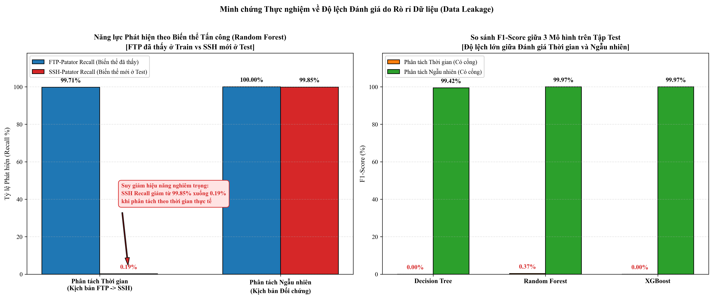

<div align="center">

# 🛡️ CICIDS2017 Brute Force Detection: Temporal Generalization & Data Leakage Benchmark

**Empirical evaluation of temporal generalization and uncovering the optimistic evaluation bias (Data Leakage) of tree-based machine learning models in network intrusion detection.**

[](LICENSE)
[](https://www.python.org/)
[](https://scikit-learn.org/)
[](https://xgboost.readthedocs.io/)
[](https://shap.readthedocs.io/)
[](https://github.com/Tuannll/cicids-bruteforce-ids/actions)

**[🚀 Quick Start](#-quick-start) • [📊 Benchmark Results](#-benchmark-results) • [🛡️ Anti-Leakage Protocol](#-scientific-anti-leakage-protocol) • [❓ FAQ](#-faq) • [📖 Full Report](docs/BAO_CAO_THUC_NGHIEM_W3_W4.md)**

[Tiếng Việt](README.vi.md) | **English**

<br/>



</div>

---

## 📌 Overview & Purpose of Repository

In Network Intrusion Detection System (NIDS) machine learning research, the vast majority of academic publications report **F1-Scores approaching 99.9%** on benchmark datasets like **CICIDS2017**. However, in real-world deployment, these systems frequently **fail completely** when encountering new attack variants.

**This repository empirically demonstrates and quantifies the underlying causes:**
1. **The Optimistic Bias of Random Split**: Random splitting (`train_test_split`) shuffles flows from the same ongoing attack campaign across both train and test partitions. This introduces severe Data Leakage—the model merely "memorizes" patterns rather than learning robust behavioral signatures.
2. **The Destination Port Shortcut**: Models latch onto service ports (e.g., `Port 21 = FTP Attack`, `Port 22 = SSH Attack`). When attack variants emerge on alternate ports or services, model performance collapses (F1 plummets from 99.9% to 0.0%).
3. **Auditable Evaluation Protocol**: Introduces a strict benchmarking framework featuring **Purge & Embargo boundary windows**, strict Train-only preprocessing (`fit` on train only), and a **Single-open Test Rule** (no tuning after test exposure).

---

## ✨ Key Methodology Highlights

| Dimension | Conventional Naive Approach | Auditable Robust Approach (This Repo) |
|---|---|---|
| **Data Partitioning** | Random Split (`train_test_split`) with shuffle | **Time-based Split** (Train in past, Val in middle, Test in future) |
| **Boundary Control** | Ignored; ongoing flows bleed across splits | **Purge & Embargo**: Flows crossing time boundaries are purged |
| **Preprocessing & Imputation** | Scalers/imputers fitted across entire dataset | **Strict Train-only fit**: Parameters learned exclusively on Train |
| **Feature Space** | Retains identifiers (IPs, Timestamp, Port shortcuts) | **Port Ablation**: Comparative evaluation with and without `Destination Port` |
| **Test Set Integrity** | Peeking and iterative tuning against Test | **Single-open Test Rule**: Model locked on Val; Test scored exactly once |
| **Model Interpretability** | Black-box accuracy reports | **Explainable AI (XAI)**: SHAP TreeExplainer & explicit decision logic |

---

## 📊 Benchmark Results

Evaluating three tree-based families: **Decision Tree (Baseline)**, **Random Forest (Bagging)**, and **XGBoost (Boosting)** on **CICIDS2017 Tuesday** (`FTP-Patator` & `SSH-Patator`).

### 1. Real-World Temporal Split (Zero-Shot Generalization Challenge)
> **Setup**: Trained **strictly on Train set** (Morning: 100% `FTP-Patator`). Evaluated on **Test set** (Afternoon: 100% `SSH-Patator`).

| Model | Feature Space | Test Accuracy | Precision | Recall | F1-Score | SSH Recall | FTP Recall | Key Observation |
|---|---|:---:|:---:|:---:|:---:|:---:|:---:|---|
| **Decision Tree** | With Port (67 feats) | 0.9740 | 0.0000 | 0.0000 | **0.0000** | 0.00% | N/A | Splits on `Port <= 21.5`, missing all 3,732 SSH flows |
| **Random Forest** | With Port (67 feats) | **0.9742** | **1.0000** | **0.0019** | **0.0037** | **0.19%** | N/A | Catches 7 SSH flows due to random feature subsampling |
| **XGBoost** | With Port (67 feats) | 0.9741 | 0.0000 | 0.0000 | **0.0000** | 0.00% | N/A | Classifies all unseen port flows as BENIGN |
| **Decision Tree** | Without Port (66 feats)| 0.9741 | 0.4375 | 0.0019 | **0.0037** | 0.19% | N/A | Port removal fails zero-shot due to statistical divergence |
| **Random Forest** | Without Port (66 feats)| 0.9739 | 0.2414 | 0.0038 | **0.0074** | 0.38% | N/A | Slight recall increase at the cost of 44 False Positives |
| **XGBoost** | Without Port (66 feats)| 0.9740 | 0.2653 | 0.0035 | **0.0069** | 0.35% | N/A | Unseen attack variant detection remains under 1% |

### 2. Random Split Control (The Illusion of Perfection)
> **Setup**: Standard randomized flow shuffling across Train, Validation, and Test.

| Model | Feature Space | Test Accuracy | Precision | Recall | F1-Score | SSH Recall | FTP Recall |
|---|---|:---:|:---:|:---:|:---:|:---:|:---:|
| **Decision Tree** | With Port (67 feats) | 0.9996 | 0.9904 | 0.9980 | **0.9942** | 99.54% | 100.0% |
| **Random Forest** | With Port (67 feats) | **0.9999** | **1.0000** | **0.9993** | **0.9997** | 99.85% | 100.0% |
| **XGBoost** | With Port (67 feats) | **0.9999** | 0.9993 | **1.0000** | **0.9997** | 100.0% | 100.0% |
| **Decision Tree** | Without Port (66 feats)| 0.9989 | 0.9700 | 0.9949 | **0.9823** | 99.23% | 99.69% |
| **Random Forest** | Without Port (66 feats)| 0.9997 | 0.9934 | 0.9954 | **0.9944** | 99.28% | 99.73% |
| **XGBoost** | Without Port (66 feats)| 0.9999 | 0.9980 | 0.9987 | **0.9984** | 99.79% | 99.92% |

---

## 🚀 Quick Start

The repository includes a self-contained synthetic fixture generator, enabling anyone to **clone and run the full end-to-end audit and training in 30 seconds** without downloading the 10 GB raw PCAP/CSV files.

### 1. Installation

```bash
git clone https://github.com/Tuannll/cicids-bruteforce-ids.git
cd cicids-bruteforce-ids

python -m venv .venv
# On Windows:
.\.venv\Scripts\Activate.ps1
# On Linux/macOS:
# source .venv/bin/activate

pip install -e ".[xai]"
```

### 2. Instant Demo (3 Seconds)

Run the trained canonical model directly on two sample flows (FTP Port 21 vs SSH Port 22) to witness the port shortcut and zero-shot challenge:

```bash
python demo.py
```

### 3. Run Comprehensive Smoke Test

```bash
python scripts/smoke_test.py --output demo_run --explain
```

### 4. Single Flow Inference via CLI

```bash
ids predict --config demo_run/configs/demo.yaml --input demo_run/example_flow.json
```

### 5. Generate Publication-Quality Figures (300 DPI)

```bash
python scripts/generate_detailed_visualizations.py
```

---

## ❓ FAQ

<details>
<summary><b>1. Why is the temporal test F1-score 0.0000? Is the pipeline broken?</b></summary>
<br/>
No. This is the central scientific discovery. The training set covers morning hours containing only <code>FTP-Patator</code>, while the test set covers afternoon hours containing only <code>SSH-Patator</code>. Tree models naturally isolate destination ports (e.g., <code>Destination Port &lt;= 21.5</code>). When presented with SSH on port 22, the model classifies it as BENIGN.
</details>

<details>
<summary><b>2. Why does Random Split reach 99.9% F1-score?</b></summary>
<br/>
Random splitting violates temporal independence. Brute-force attacks consist of thousands of contiguous flows with identical IPs, ports, and duration characteristics. Shuffling places identical flow artifacts in both Train and Test, allowing the model to memorize the attack campaign.
</details>

<details>
<summary><b>3. Does removing the destination port solve zero-shot detection?</b></summary>
<br/>
No. Without ports, F1 increases only to 0.0074 while generating 44 false alarms. The underlying packet inter-arrival times and window dynamics differ substantially between FTP and SSH brute force.
</details>

<details>
<summary><b>4. Can I test this without downloading the raw CICIDS2017 dataset?</b></summary>
<br/>
Yes. Run <code>python scripts/smoke_test.py</code>. It generates structurally identical synthetic network flows and verifies all protocol invariants.
</details>

---

## 📄 License

Distributed under the **MIT License**. See [LICENSE](LICENSE) for details.
